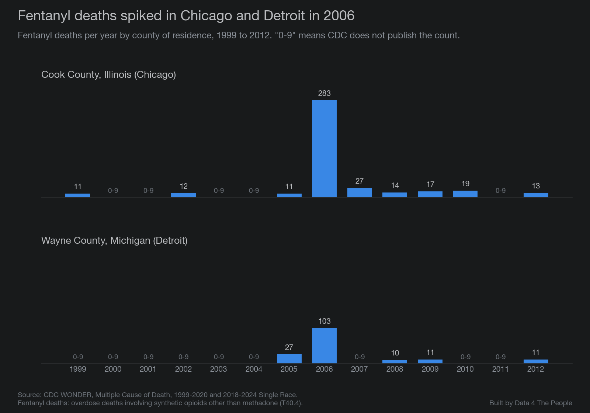

# Fentanyl Deaths, County by County: An Interactive Map, 1999 to 2024

Earlier this week we published a map of substance use treatment in every state. While building it, we looked at which drugs were behind the rise in overdose deaths. One answer stood out. From 2013 to 2022, yearly overdose deaths in the U.S. went up by 63,959, from 43,982 to 107,941. Over the same years, deaths involving fentanyl went up by 70,733, from 3,105 to 73,838. Overdose deaths that did not involve fentanyl went down by 6,774. In those years, the whole rise was in deaths involving fentanyl.

Over a longer span, 2001 to 2022, deaths involving fentanyl account for 82% of the rise in overdose deaths. Fentanyl was involved in 7% of overdose deaths in 2013, 51% in 2019 and 68% in 2022. When overdose deaths finally fell in 2024, fentanyl was the story again: overdose deaths fell by 25,623, and deaths involving fentanyl fell by 25,041, or 98% of the drop. The chart below shows overdose deaths each year, split into deaths that involved fentanyl and deaths that did not.

*Source: CDC WONDER, Multiple Cause of Death.*

On the drug side, fentanyl is the story, so that is where we started. This post has a map of fentanyl deaths in every U.S. county for every year from 1999 to 2024, a short history of how fentanyl got here, a look at the counties that stand out, and what is known, and not known, about why deaths fell in 2024.

A note on words. In this post, "fentanyl deaths" means CDC's count of overdose deaths that involve synthetic opioids other than methadone. Most of these are illegally made fentanyl. The group also includes tramadol and a few other drugs. Many of these deaths involve more than one drug, so "involving fentanyl" does not mean fentanyl was the only drug.

<iframe src="https://data4thepeople.github.io/FentanylDeaths/?v=20261106a#embed=1" width="100%" height="1080" loading="lazy" style="border:0" title="Fentanyl Deaths, County by County: interactive map, 1999 to 2024"></iframe>

::: spacer 40px

::: blurb
**[Open the full map](https://data4thepeople.github.io/FentanylDeaths/)** **for the title and the full notes.**
:::

::: spacer

## Using the map

::: spacer 5px

**1. Pick a year.** Drag the slider, or press play to move through every year from 1999 to 2024. Play runs at 1x, 2x or 3x speed.

**2. Click a county.** The panel beside the map shows its deaths and death rate, with a trend line next to its state and the U.S.

**3. Pick a state.** The menu above the map zooms to one state. The ranking and the bar chart below the map then show only that state.

**4. Zoom and move.** Use + and − to zoom in, drag to move around, and Reset view to go back to the whole country.

**5. Jump to a year.** Click a bar in the bar chart.

### How to read it

- **Darker red** means a higher death rate, per 100,000 residents.
- **Gray counties had 0 to 9 deaths.** CDC's data rules bar publishing counts that small, so the map cannot show which of these counties had none.
- **Hatched counties had 10 to 19 deaths.** Rates based on so few deaths can swing a lot from year to year by chance.
- **DC** has its own small box, east of the coast, with a line pointing to it.

In 1999, only 6 counties had 10 or more fentanyl deaths. In 2013 there were 55. By 2022 there were 991, and those counties held 94% of the country's fentanyl deaths.

## How fentanyl got here

::: spacer 5px

Fentanyl started as a medicine. A Belgian chemist, Paul Janssen, first made it around 1960 ([review, *International Journal of Molecular Sciences*](https://pmc.ncbi.nlm.nih.gov/articles/PMC11765396/)). The FDA approved it as an injected anesthetic called Sublimaze in 1968 ([CDEK](https://cdek.data4thepeople.com/drugs/98141); [FDA](https://www.accessdata.fda.gov/scripts/cder/daf/index.cfm?event=overview.process&ApplNo=016619)) and as the Duragesic skin patch in 1990 ([FDA](https://www.accessdata.fda.gov/scripts/cder/daf/index.cfm?event=overview.process&ApplNo=019813)). DEA says it is "approximately 100 times more potent than morphine and 50 times more potent than heroin" as a painkiller ([DEA](https://www.dea.gov/factsheets/fentanyl)).

Illegally made fentanyl showed up long before the recent crisis. In 1979, fentanyl-type drugs sold as "China White" appeared on the streets in California ([*Journal of Forensic Sciences*](https://europepmc.org/article/MED/3286815)). From April 2005 to March 2007, CDC and DEA tied 1,013 deaths to illegally made fentanyl, most of them in the Chicago, Philadelphia and Detroit areas. Deaths peaked in June 2006, a month after police closed a fentanyl lab in Toluca, Mexico ([CDC](https://www.cdc.gov/mmwr/preview/mmwrhtml/mm5729a1.htm)). DEA then put limits on two chemicals used to make fentanyl, in 2007 and 2010 ([DEA](https://www.deadiversion.usdoj.gov/drug_chem_info/fentanyl.pdf)). You can see part of that outbreak on the map in 2006: Cook County, Illinois, had 283 fentanyl deaths and Wayne County, Michigan, had 103.

*Source: CDC WONDER, Multiple Cause of Death.*

Philadelphia, where CDC counted 269 outbreak deaths, shows fewer than 10 on the map in each of those years. We have not found the reason, and it is one more sign that counts from early years should be read with care.

CDC describes the opioid crisis in three waves ([CDC](https://www.cdc.gov/overdose-prevention/about/understanding-the-opioid-overdose-epidemic.html)). The first began with more opioid prescribing in the 1990s. The second began in 2010 with a fast rise in heroin deaths. The third began in 2013, with deaths involving synthetic opioids, "particularly those involving illegally made fentanyl." On the map, the U.S. fentanyl death rate was 1.0 per 100,000 people in 2013 and 22.2 in 2022. From 2014 to 2015 alone it rose 72%, and CDC said that rise was "likely driven primarily by illicitly manufactured fentanyl" ([CDC](https://www.cdc.gov/mmwr/volumes/65/wr/mm655051e1.htm)). The chart below shows the three waves in the death rate for each type of opioid.

*Source: CDC WONDER, Multiple Cause of Death.*

DEA has described how the supply worked. In 2018 it told Congress that fentanyl and the chemicals used to make it were "often produced in China" and shipped by mail to the U.S., or to groups in Mexico, Canada and the Caribbean. There it was mixed into heroin and other drugs or pressed into pills ([DEA testimony, 2018](https://www.justice.gov/file/1099336/download)). Drug labs reported finding fentanyl 36,061 times in 2016, up from 1,042 in 2013. By 2023, DEA said the Sinaloa and Jalisco cartels bought the chemicals in China, made fentanyl in Mexico, and pressed it into fake pills that look like prescription drugs. It said 6 in 10 of the fake pills it tested held a potentially deadly dose ([DEA testimony, 2023](https://judiciary.house.gov/sites/evo-subsites/republicans-judiciary.house.gov/files/evo-media-document/milgram-testimony.pdf)). DEA counts 2 milligrams of fentanyl as a potentially deadly dose ([DEA](https://www.dea.gov/onepill)).

Fentanyl is also mixed into other drugs. DEA says it "is often mixed with other drugs, such as heroin and cocaine," and that people may not know it is there ([DEA](https://www.deadiversion.usdoj.gov/drug_chem_info/fentanyl.pdf)). In 2025, DEA reported that fentanyl purity was going down, while fentanyl mixed with animal tranquilizers was on the rise ([DEA](https://www.dea.gov/press-releases/2025/05/15/dea-releases-2025-national-drug-threat-assessment)).

## The counties that stand out

::: spacer 5px

Here we count only counties with 20 or more fentanyl deaths in a year, the same rule the map's ranking uses. Small counties can post very high rates from a handful of deaths.

**Southern West Virginia has the highest rates on record.** McDowell County, West Virginia, had 206.4 fentanyl deaths per 100,000 residents in 2023 (36 deaths), the highest rate for any county in any year. If you rank counties by their worst year, eight of the top ten are in West Virginia: McDowell, Wyoming, Logan, Mercer, Raleigh, Cabell, Mason and Fayette. The other two are Baltimore city and Scioto County, Ohio.

*Source: CDC WONDER, Multiple Cause of Death.*

**Baltimore stands out among big cities.** Baltimore city had the highest rate in the country in 2024, 95.2 per 100,000 (541 deaths). Its worst year was 2021, at 135.6 per 100,000 (782 deaths). Baltimore city, Cabell County, West Virginia (home to Huntington), and St. Louis city were in the country's top 25 by rate every year from 2016 to 2024.

**High rates are not only in the East.** In 2024, Rio Arriba County, New Mexico, had the second-highest rate in the country (80.1 per 100,000, 32 deaths). Anchorage, Alaska, was seventh (55.9 per 100,000, 162 deaths).

**The most deaths are in big counties with lower rates.** In 2024, Maricopa County, Arizona, had 1,005 fentanyl deaths (21.5 per 100,000), Cook County, Illinois, had 990 (19.1) and Los Angeles County had 988 (10.1).

## 2024: a drop almost everywhere

::: spacer 5px

Fentanyl deaths fell from 72,776 in 2023 to 47,735 in 2024. The death rate fell 35.6%, more than for any other drug group CDC tracks ([CDC](https://www.cdc.gov/nchs/products/databriefs/db549.htm)).

**Every state with numbers for both years fell.** That is 49 states, counting DC. Hawaii's 2024 total and New Hampshire's 2023 total are not shown, to protect small county counts. The largest drops were in West Virginia (down 48.4%), Arkansas (46.6%), North Dakota (46.1%), Virginia (45.8%) and Wisconsin (45.7%). The smallest were in the West: Nevada (down 4.9%), Alaska (6.9%), Utah (9.8%), Washington (13.5%) and Arizona (16.5%).

*Source: CDC WONDER, Multiple Cause of Death.*

**Nearly every county fell too.** Of 435 counties with 20 or more fentanyl deaths in both 2023 and 2024, 411 (94.5%) had fewer deaths in 2024. Five were unchanged and 19 rose. With a lower bar, 10 or more deaths in both years, 639 of 706 counties (90.5%) fell.

**It was not a change in how deaths were recorded.** All overdose deaths fell 26%, no matter which drug was named. Overdose deaths where the drug was not named also fell, from 39,160 to 29,771, so fentanyl deaths were not just moved into an "unknown drug" group.

**The drop was almost all fentanyl.** The number of fentanyl deaths fell 34.4%. Overdose deaths that did not involve fentanyl fell 1.8%, from 32,231 to 31,649.

### The counties that went the other way

Nineteen counties had more fentanyl deaths in 2024 than in 2023. Nine are in Western states, and three of those are in Washington.

*Source: CDC WONDER, Multiple Cause of Death.*

Spokane County, Washington, had the largest increase, from 176 to 249 deaths (31.9 to 44.8 per 100,000). Clark County, Nevada, home to Las Vegas, had the most deaths of the group, 519 in 2024.

We did not find a source that explains why these counties, or the West as a whole, fell less.

### What may explain the drop

The short answer is that it is not settled. CDC named several possible reasons: wider use of naloxone (the overdose-reversal drug), better access to treatment, changes in the illegal drug supply, and prevention programs such as Overdose Data to Action. CDC did not rank them or measure how much each one did ([CDC](https://www.cdc.gov/media/releases/2025/2025-cdc-reports-decline-in-us-drug-overdose-deaths.html)).

Researchers have tested some of these ideas:

- **The drug supply.** A paper in *Science* argues that a disruption in the fentanyl supply in 2023 was most likely the main driver ([University of Maryland summary](https://today.umd.edu/study-global-fentanyl-supply-disruption-led-to-drop-in-opioid-overdose-deaths)). DEA reports that 29% of the fentanyl pills it tested in fiscal year 2025 held a potentially deadly dose, down from 76% two years earlier ([DEA](https://www.justice.gov/jmd/media/1434526/dl)).
- **Only fentanyl deaths fell.** A study of the same CDC data we use found the same split we did, with fentanyl deaths falling sharply and other overdose deaths barely moving. The author says this fits a change in the fentanyl supply better than broad program effects. That study has not been peer-reviewed ([medRxiv](https://www.medrxiv.org/content/10.64898/2025.12.04.25341579.full.pdf)).
- **Drug seizures.** A study in *JAMA Health Forum* tied about 9% of the drop to fentanyl's falling share of drug seizures, and its authors say other factors are likely at work ([study](https://pmc.ncbi.nlm.nih.gov/articles/PMC12811803/)).
- **Naloxone.** A study in *JAMA* found that emergency crews gave naloxone at about the same rate per overdose as before the drop ([Brown University](https://www.brown.edu/news/2026-10-21/naloxone-overdose-deaths-trend)).
- **Pushback on the supply idea.** A peer-reviewed paper in *Science Advances* found that national fentanyl purity "did not track fatal fentanyl overdose rates in most United States regions" and does not explain the drop on its own ([USC Schaeffer](https://schaeffer.usc.edu/research/fentanyl-purity-and-overdose-decline-a-reexamination-of-geographic-trends/)).

In our view, the evidence leans toward changes in the drug supply. We did not find a study that measures how much treatment, naloxone or prevention programs added.

## Looking ahead

::: spacer 5px

What worries us is the unknown. Deaths fell fast, and the people who study it do not agree on why. If the drop came mostly from changes in the drug supply, it could reverse if the supply changes again. The authors of the *Science* paper write that "How long the decline will last is uncertain" and that "Treatment, prevention and harm-reduction efforts remain essential" ([University of Maryland summary](https://today.umd.edu/study-global-fentanyl-supply-disruption-led-to-drop-in-opioid-overdose-deaths)). The supply is still changing. DEA warns that medetomidine, "a more powerful veterinary anesthetic," has started to show up in fentanyl ([DEA](https://www.dea.gov/press-releases/2025/05/15/dea-releases-2025-national-drug-threat-assessment)). And deaths are still high: CDC's early count is 67,798 overdose deaths in the 12 months ending in March 2026 ([CDC](https://www.cdc.gov/media/releases/2026/cdc-launches-new-overdose-prevention-data-channel.html)).

That is why the funding matters. Cutting programs on the belief that the problem is solved would remove support while researchers still disagree about what is holding deaths down.

**What Congress has done.** For fiscal year 2026, Congress kept the main programs about level. The State Opioid Response grants, which pay for treatment, naloxone and recovery services in every state, are $1.595 billion. The substance use block grant to states is $2.013 billion ([GHAI](https://assets.advocacyincubator.org/uploads/2026/FY-2027-Appropriations-Crosswalk-SAMHSA-Funding-1.pdf)). Funding for fiscal year 2027 has not passed. For now, programs run at 2026 levels through December 11, 2026 ([Congressional Research Service](https://www.everycrsreport.com/reports/R49344.html)).

**What has been proposed.** HHS's budget request for fiscal year 2027 would ([HHS](https://www.hhs.gov/sites/default/files/fy-2027-budget-in-brief.pdf)):

- merge the State Opioid Response grants and two block grants into one $4.621 billion block grant, the same total as today
- cut substance abuse prevention programs from $350 million to $89 million, and treatment programs from $564 million to $490 million
- move CDC's injury center, which runs its overdose programs, into a new agency at $588 million, down from $761 million
- fold SAMHSA, the agency that runs most of these grants, into that new agency

These are proposals. Congress decides the final amounts.

**Grants cut and then restored.** In January 2026, SAMHSA ended about $2 billion in grants and reversed the decision the next evening ([NACo](https://www.counties.org/news-and-media-article/samhsa-terminates-2-billion-grant-funding-quickly-rescinds-terminations/)). In mid-2025, about $140 million in Overdose Data to Action money was held back, and CDC staff later said they expected it to be paid in full ([KAXE/NPR](https://www.kaxe.org/news/2025-08-05/cdc-to-disburse-delayed-funds-for-fighting-fentanyl-and-more-staffers-say)).

**Medicaid.** Medicaid covers about one-fifth of adults with a substance use disorder ([KFF](https://www.kff.org/medicaid/implications-of-medicaid-work-and-reporting-requirements-for-adults-with-mental-health-or-substance-use-disorders)). The 2025 budget law adds work requirements and eligibility checks every six months, starting around the end of 2026. People in substance use treatment are exempt from the work requirements ([KFF](https://www.kff.org/medicaid/health-provisions-in-the-2025-federal-budget-reconciliation-law/)).

### When the next data comes out

CDC added final 2024 death data to its WONDER database in February 2026 ([CDC WONDER](https://wonder.cdc.gov/whatsnew.html)). It has not announced a date for final 2025 data. If it follows last year's timing, that would be early 2027. CDC's early count for 2025 is 69,973 overdose deaths, down almost 14% from 2024, but that count does not break out fentanyl ([CDC](https://www.cdc.gov/nchs/pressroom/releases/20260513.html)).

When the final 2025 county data comes out, we will add it to the map and update this post.

## How we built it

::: spacer 5px

Every number on the map can be checked and rebuilt. The full method is in [DATASETS.md](https://github.com/Data4ThePeople/FentanylDeaths/blob/main/DATASETS.md), and the checks are in [TIEOUT.md](https://github.com/Data4ThePeople/FentanylDeaths/blob/main/TIEOUT.md).

- **Source.** CDC WONDER, Multiple Cause of Death: the 1999-2020 database for 1999 to 2017, and the 2018-2024 Single Race database for 2018 to 2024. The two databases give the same county counts for 2018 to 2020.
- **What counts as a fentanyl death.** A death whose underlying cause was a drug overdose (accidental, suicide, homicide or undetermined) and whose death certificate lists synthetic opioids other than methadone (ICD-10 code T40.4).
- **Where.** Deaths are counted in the county where the person lived, not where they died.
- **Rates.** Crude rates per 100,000 residents in every year, because CDC does not give county age-adjusted rates in its newer database. For 1999 to 2017, CDC does not show rates for counties with 10 to 19 deaths, so we calculate them the way CDC does: deaths divided by population, times 100,000.
- **Small counts.** CDC does not publish county counts of 1 to 9, and its data rules bar publishing any count of 9 or fewer. Those counties are gray. Where a state's total would let a reader work out a small county count by subtraction, we leave the state's total out for that year (43 state-years).
- **Checks.** A script recomputes every number on the map from CDC's files, about 250,000 values, with no differences. A separate check, written from scratch, pulled the data again and found no differences.

## Limits

::: spacer 5px

- **T40.4 is not only fentanyl.** It also includes tramadol and other synthetic opioids. CDC uses it as its measure of fentanyl deaths.
- **Early years are likely undercounted.** From 1999 through 2013, 21% to 25% of overdose death certificates did not name any drug ([CDC](https://www.cdc.gov/nchs/products/databriefs/db329.htm)). By 2023, 4% did not ([CDC](https://www.cdc.gov/nchs/products/databriefs/db522.htm)). Fentanyl deaths in early years, and in places that named drugs less often, are likely higher than the map shows.
- **Gray does not mean zero.** A gray county had somewhere from 0 to 9 deaths.
- **Small-county rates swing.** Rates based on fewer than 20 deaths can change a lot from year to year by chance.
- **Crude rates are not adjusted for age.** Counties with older residents may show lower rates partly because fewer residents are in the ages most affected.
- **County lines changed.** Some Alaska and Virginia areas were merged or redrawn. Connecticut has no county rates from 2022, because Census no longer makes county population estimates there.

## Reproduce it yourself

::: spacer 5px

The code, the data and the full method are at [github.com/Data4ThePeople/FentanylDeaths](https://github.com/Data4ThePeople/FentanylDeaths). If you get a different number from us, tell us, and we will look.
